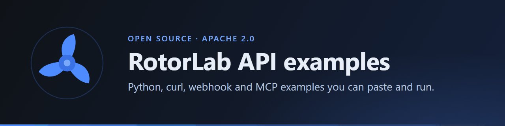
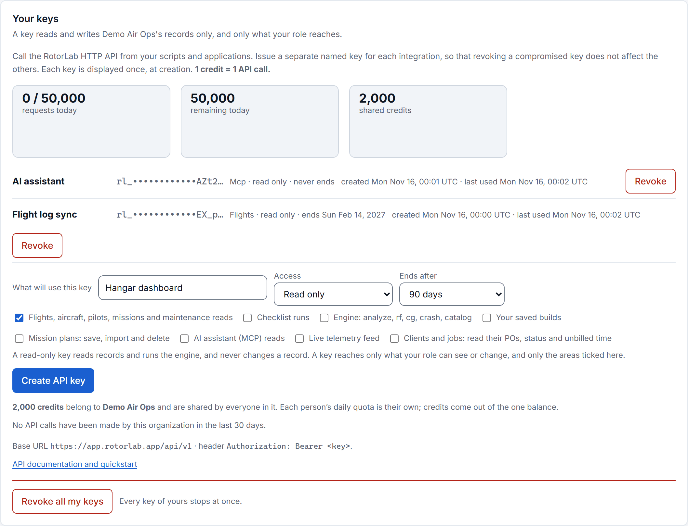
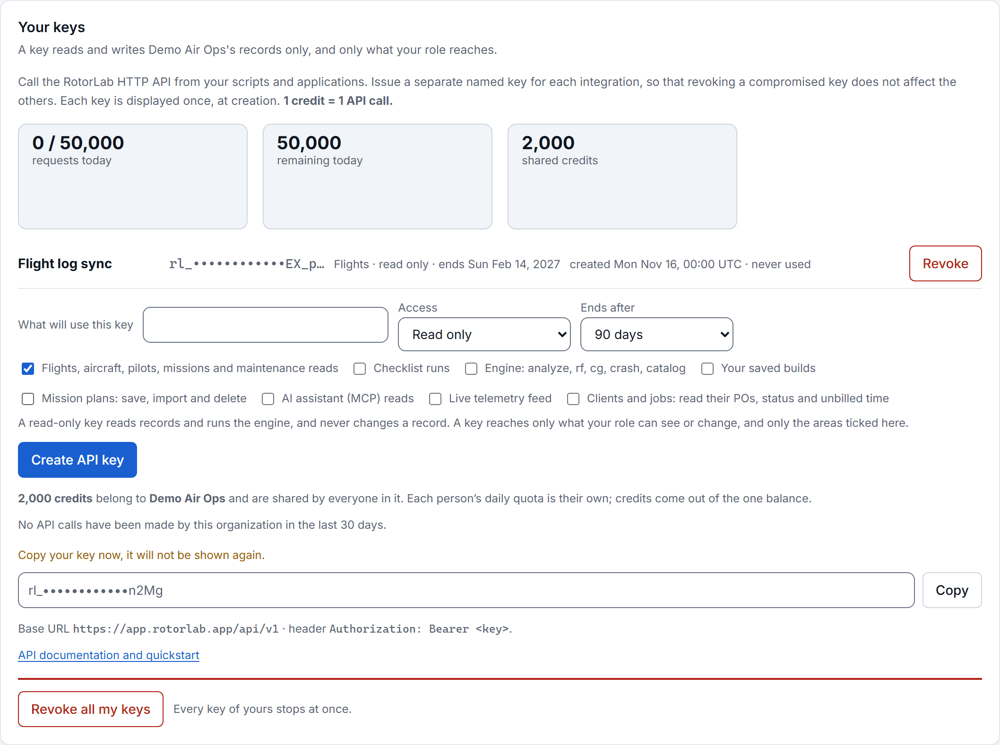
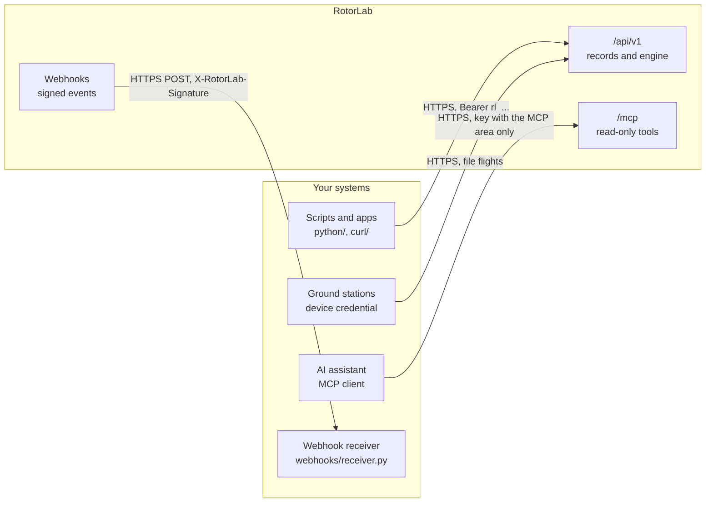

<p align="center">
  
</p>

<p align="center">
  <a href="https://github.com/RotorLabApp/rotorlab-api-examples/releases/latest"></a>
  <a href="LICENSE"></a>
  
  
  
</p>

# RotorLab API examples

**From an API key to your first answer in five minutes, with code that runs as pasted.**

- **Standard library only.** Every script runs on Python 3.8 or later with nothing to install, on macOS, Linux and Windows.
- **Safe by default.** Keys come only from the environment, travel only over `https://`, and never follow a redirect.
- **Records and the engine.** Read your aircraft register, pilots and flights, file flights from a ground station, attach logs, and run builds through the physics engine.
- **Events, pushed.** A webhook receiver that verifies every signature, drops replays, and tells RotorLab to retry when your handler fails.
- **Your AI assistant, read-only.** Connect Claude or your own agent to RotorLab's read-only MCP endpoint with a key that reaches nothing else.

**[Quick start](#quick-start-key-to-first-call-in-five-minutes)** | **[Developers](https://rotorlab.app/developers)** | [Documentation](https://docs.rotorlab.app/) | [Talk to sales](https://rotorlab.app/contact-sales)

Working examples for the RotorLab API: Python scripts, curl one-liners, a webhook receiver and an MCP setup for AI assistants, plus copies of the published OpenAPI document and Postman collection.

RotorLab joins a physics-based build and analysis engine to a drone fleet records platform, and the API reaches both. Run a multirotor, wing or VTOL build through the engine, work out radio link budgets and balance, and send a flight log for forensics after an incident. Then file what your ground stations flew and read your register and your pilots' standing into your own systems. Supported log formats include ArduPilot, PX4, MAVLink, DJI, Parrot, GUTMA, Blackbox and CSV exports, and the format is detected from the file itself; see the developer page for the full list.

RotorLab records, reminds and warns. It never authorizes, approves or clears a flight. A readiness reading or a currency value in an API answer says what your organization's records show; the decision to fly stays with the people and authorities responsible for it.

## Contents

- [Get an API key](#get-an-api-key) and the [quick start](#quick-start-key-to-first-call-in-five-minutes)
- [How the pieces connect](#how-the-pieces-connect)
- [What a run looks like](#what-a-run-looks-like)
- [Base URL, endpoints, errors, paging and quotas](#base-url-and-authentication)
- [Webhooks](webhooks/README.md), [MCP](mcp/README.md), [curl](curl/README.md), [OpenAPI](openapi/README.md), [Postman](postman/README.md)
- More in [`docs/`](docs/): [troubleshooting](docs/troubleshooting.md), [FAQ](docs/faq.md), [security model](docs/security-model.md), [compatibility](docs/compatibility.md)

## Get an API key

1. Sign in to RotorLab and open **Organization, Integrations, API keys**.
2. Name the key, tick only the areas it needs (untick the rest), choose **read only** or **read and write**, and choose when it ends.
3. Click **Create API key**. The key is shown once: copy it somewhere safe. Keys start with `rl_`.

<p align="center">
  <picture>
    <source media="(prefers-color-scheme: dark)" srcset="docs/images/api-key-form-dark.png">
    
  </picture>
  <br><sub>A new read-only key with one area ticked. Fictional demo organization; existing keys are masked.</sub>
</p>

Once created, the key is shown once with a **Copy** button, and the card lists it with its areas, access and end date:

<p align="center">
  <picture>
    <source media="(prefers-color-scheme: dark)" srcset="docs/images/api-key-created-dark.png">
    
  </picture>
  <br><sub>The key is shown once at creation. It is masked in this picture.</sub>
</p>

Who may create keys is the organization's choice. By default it is organization admins and roles with Integrations (manage); an admin can open it to every member, or allow no personal keys at all. The organization also sets the longest a key may last, and its admins see and can revoke every key. A person may hold up to 25 active keys: give each integration its own, so revoking one leaves the others working.

A key acts for the person who holds it. It reaches only what that person's role reaches, and the organization's two-factor and single sign-on rules apply to it.

### Keep the key out of history and files

Set `ROTORLAB_API_KEY` by pasting the key at a prompt, not by typing it into a command, so it is not saved in your shell history:

```bash
read -rs ROTORLAB_API_KEY && export ROTORLAB_API_KEY      # macOS, Linux or Git Bash; paste, then Enter
```

```powershell
$env:ROTORLAB_API_KEY = Read-Host "Paste your API key"   # Windows PowerShell
```

Never write the key into a script, a committed config file or a command line. On a server, load it from your secret store into the environment. If a key may have been exposed, revoke it under Organization, Integrations, API keys and create a new one.

## Quick start: key to first call in five minutes

1. Create a key as above: tick `flights` (read only is enough), choose when it ends, and click **Create API key**. Copy it now: it is shown once.
2. Set two variables. macOS, Linux or Git Bash:

   ```bash
   read -rs ROTORLAB_API_KEY && export ROTORLAB_API_KEY    # paste the key, then Enter
   export ROTORLAB_URL="https://app.rotorlab.app"
   ```

   Windows PowerShell:

   ```powershell
   $env:ROTORLAB_API_KEY = Read-Host "Paste your API key"
   $env:ROTORLAB_URL = "https://app.rotorlab.app"
   ```

3. Check the key (free, uses no quota):

   ```bash
   python python/check_key.py
   ```

   You should see your server, the areas the key reaches and today's quota. A 401 means the key is wrong, revoked or ended.
4. Read your register (free):

   ```bash
   python python/list_aircraft.py
   ```

5. Read one aircraft's record, using a name from step 4:

   ```bash
   python python/aircraft_record.py "<an aircraft name from step 4>"
   ```

Records calls are never metered, so nothing here spends a quota or credit. The scripts need Python 3.8 or later and nothing else. The same calls as curl are in [`curl/README.md`](curl/README.md). A readiness reading or a currency value says what your records show; it never authorizes or clears a flight.

### Areas

Every key carries `status` (version and usage). The other areas are ticked when the key is created:

| Area | What it reaches |
|---|---|
| `flights` | Flights, aircraft, pilots, sorties, missions (reads), work orders, components, types, service bulletins, health, advisory scores |
| `checklists` | Checklist templates and completed runs |
| `engine` | `analyze`, `rf`, `cg`, `airframes`, `catalog`, and log forensics (`crash`) |
| `builds` | Your own saved builds |
| `missions` | Saving, importing and deleting mission plans |
| `jobs` | Clients and jobs (read only) |
| `mcp` | The MCP endpoint for AI assistants (see [`mcp/`](mcp/)) |
| `live` | The live telemetry relay (see the developer page) |

A **read-only** key reads records and runs the engine; it never changes a record.

Ground stations and other equipment use a **device credential** instead of a personal key. It belongs to the organization, so it keeps working after the person who created it leaves, and it reaches the `status`, `flights` and `checklists` areas.

## How the pieces connect



- **Pull:** your scripts call `/api/v1` with a personal key, or a ground station files flights with a device credential.
- **Push:** RotorLab posts signed events to your `https://` endpoint as they happen, and retries a delivery your endpoint does not accept.
- **Ask:** an AI assistant reads your records through the read-only MCP endpoint, with a key that has only the MCP area.

## What a run looks like

These are real runs of this release's scripts, made on Windows 11 with Python 3.14 (Git Bash) against a throwaway RotorLab server on the same computer, filled with the fictional demo organization "Demo Air Ops". Because the server was on this computer, `ROTORLAB_URL` was a plain `http://127.0.0.1` address, which the scripts accept only for this computer; you use `https://app.rotorlab.app`. Key prefixes are masked, and the server's version number is left out.

Check the key (free, no quota spent):

```console
$ python python/check_key.py
Server:     RotorLab <version>
Key:        Flight log sync (rl_••••••••...)
Areas:      status, flights
Access:     read only
Ends:       2027-02-14T00:00:29Z
Quota:      50000 of 50000 metered calls left today (UTC); 2000 credits
Log limit:  512 MB per uploaded flight log
```

Read the aircraft register and one aircraft's record:

```console
$ python python/list_aircraft.py
ID     NAME                 REG          MODEL                  STATUS      FLIGHTS    HOURS
1      DEMO-01              N101DM       Survey quad            active            2      0.5
2      DEMO-02              N102DM       Mapping hex            active            2      0.6
3      DEMO-03              N103DM       VTOL trainer           active            2      0.6
3 aircraft
$ python python/aircraft_record.py DEMO-01
DEMO-01  (id 1)
  Registration: N101DM   Serial: -   Model: Survey quad
  Status: active   Flights on record: 2   Hours: 0.5

What the records show (information, not a clearance to fly):
  Readiness state: advisory   (No flags, 1 note)
  - [advisory] No maintenance program is applied.
  Not on record yet: type, program
  Health flags from 0 measured flights:
  - [info] No measured flights yet

Most recent flights:
  #4      2026-11-06 15:00:00+00:00   17.0 min  Jordan Lee         Demo Field
  #1      2026-11-03 15:00:00+00:00   14.0 min  Alex Rivera        Demo Field
```

Pilots and recent flights:

```console
$ python python/list_pilots.py
2      Alex Rivera              org_admin   currency: no pilot certificate on file in RotorLab (a record gap, not a lapse)  last flight 2026-11-07
3      Jordan Lee               user        currency: no pilot certificate on file in RotorLab (a record gap, not a lapse)  last flight 2026-11-08
2 pilot(s) listed.
Currency is reported so a crew knows where they stand. It must not be used to prevent a flight.
$ python python/list_flights.py --limit 3
#6      2026-11-08 15:00:00+00:00 aircraft 3       19.0 min  Jordan Lee         Demo Field
#5      2026-11-07 15:00:00+00:00 aircraft 2       18.0 min  Alex Rivera        Demo Field
#4      2026-11-06 15:00:00+00:00 aircraft 1       17.0 min  Jordan Lee         Demo Field
3 flight(s)
```

The MCP client, with a key that has only the **AI assistant (MCP) reads** area:

```console
$ cd mcp
$ python mcp_call.py list
fleet_overview           Fleet overview
aircraft_health          One aircraft's health
recent_flights           Recent flights
open_work_orders         Open work orders
open_occurrences         Open occurrences
battery_packs            Battery packs
readiness                Readiness meter
maintenance_experience   Maintenance experience
$ python mcp_call.py call recent_flights --args '{"limit": 2}'
{
  "flights": [
    {
      "aircraft": "DEMO-03",
      "duration_min": 19.0,
      "flown_at": "2026-11-08T15:00:00+00:00",
      "id": 6,
      "site": "Demo Field",
      "type": ""
    },
    {
      "aircraft": "DEMO-02",
      "duration_min": 18.0,
      "flown_at": "2026-11-07T15:00:00+00:00",
      "id": 5,
      "site": "Demo Field",
      "type": ""
    }
  ],
  "limit_max": 50,
  "next_cursor": "eyJmIjoiMjAyNi0xMS0wNyAxNTowMDowMCswMDowMCIsImkiOjV9"
}
```

The webhook receiver. A small test script on the same computer, standing in for RotorLab, sent it one correctly signed delivery, the same body again under another delivery id, and a delivery with a wrong signature. The secret is a throwaway test value.

```console
$ ROTORLAB_WEBHOOK_SECRET=whsec_demo_only_not_a_real_secret python webhooks/receiver.py --port 8090
Listening on http://127.0.0.1:8090/
2026-11-16 00:02:26  workorder.raised  {"asset_id": 1, "order_id": 88, "origin": "manual", "priority": "routine", "title": "Replace motor 3"}
```

What the three senders got back:

```text
signed delivery    -> 200 ok
same body again    -> 200 already handled
wrong signature    -> 401 bad signature
```

The event was handled once, the replay was answered without being acted on again, and the forged delivery was refused. Messages and fixes for common failures are in [docs/troubleshooting.md](docs/troubleshooting.md).

## Base URL and authentication

```
https://app.rotorlab.app/api/v1
```

Send the key as a bearer token:

```bash
curl -H "Authorization: Bearer $ROTORLAB_API_KEY" https://app.rotorlab.app/api/v1/version
```

The header `X-API-Key: <key>` is accepted too. Request and response bodies are JSON, except the two flight log uploads, whose body is the raw file.

## Endpoints used here

| Call | Area | Metered | Example |
|---|---|---|---|
| `GET /version`, `GET /usage` | `status` | no | [`check_key.py`](python/check_key.py) |
| `GET /aircraft` | `flights` | no | [`list_aircraft.py`](python/list_aircraft.py) |
| `GET /health/{id}` with `GET /flights?asset_id=` | `flights` | no | [`aircraft_record.py`](python/aircraft_record.py) |
| `GET /pilots` | `flights` | no | [`list_pilots.py`](python/list_pilots.py) |
| `GET /flights` | `flights` | no | [`list_flights.py`](python/list_flights.py) |
| `POST /flights` | `flights` | no | [`file_flight.py`](python/file_flight.py) |
| `POST /flights/{id}/log` | `flights` | no | [`attach_log.py`](python/attach_log.py) |
| `POST /analyze` | `engine` | yes | [`analyze_build.py`](python/analyze_build.py) |

The same calls as curl one-liners are in [`curl/README.md`](curl/README.md). Every operation (including checklists, missions, work orders, components, types, service bulletins, sorties, jobs, clients, saved builds, radio link budgets, center of gravity and log forensics) is listed in the [OpenAPI document](openapi/) and on the developer page, each with its `x-area` and `x-metered`.

Records are your organization's and builds are your own: anything else answers `404`.

### Filing flights safely

`POST /flights` takes your own `external_ref` for each flight. Sending the same reference again from the same key corrects that flight in place instead of filing a second copy, so a station can retry after a dropped link. Give each station its own key: two stations sharing one key are one sender. File the flight first and attach its log second, so a failed upload never costs the flight record.

## Errors

Every error is JSON with an `error` sentence that says what to do, and, where it helps a program branch, a field beside it.

| Status | Meaning | Branch on |
|---|---|---|
| 400 | A body or value the call cannot read; the error names the field | |
| 401 | No key, or a key that was revoked, has ended, or whose holder's access ended | |
| 402 | An add-on the account lacks, or a plan with no API calls and no credits | `quota: "none"` |
| 403 | The key lacks the area, is read only, the holder's role does not reach it, two-factor or single sign-on is outstanding, or the plan has ended | `area`, `read_only`, `mfa_setup_required`, `sso` |
| 404 | No such record in your organization, or a path that is not an endpoint (never metered) | |
| 405 | The path exists but not with this method; the `Allow` header names the ones it takes | `Allow` |
| 409 | Refused because of the record's state, for example a log already stored with another flight | `duplicate_of` |
| 410 | A queued log reading that has expired | |
| 413 | Over the limit: 4 MB for a JSON body, 64 MB for a forensics log, 512 MB for a log attached to a flight | |
| 429 | Today's quota and credits are spent, or five of your logs are already waiting to be read | `quota: "exhausted"`, `waiting`, `Retry-After` |
| 503 | A forensics log not read in time; collect it later from `status_url` at no further cost | `token`, `status_url` |

The Python examples print the status, the sentence and these fields, and exit with status 1.

## Pagination

The `/api/v1` list endpoints have no cursor. Narrow `GET /flights` with `since` (a date), `asset_id` and `pilot_id`, and set `limit` (default 200, at most 2,000), newest flown first. The MCP tool `recent_flights` pages with `next_cursor`.

## Quotas and rate limits

A metered call spends one unit. The engine, saved builds and uploading a log for forensics are metered. Everything that files or reads your organization's own records is not: flights, checklists, missions, pilots, sorties, aircraft, work orders, components, types, service bulletins, health and scores are free, so filing a record is never stopped by a quota. `version` and `usage` are free too. A refused call and an unknown path spend nothing.

Your plan sets a daily quota, which resets at 00:00 UTC and is spent first; after it, calls draw on your organization's credit balance. When both are spent the API answers `429` with `Retry-After` set to the seconds until the reset. Every metered response carries `X-RateLimit-Limit`, `X-RateLimit-Remaining` and `X-RateLimit-Credits`, and `GET /api/v1/usage` reports the same at any time.

The MCP endpoint spends no quota or credits; each key may send it 60 requests a minute and 1,000 an hour.

## What is in this repository

| Folder | Contents |
|---|---|
| [`python/`](python/) | Standard-library scripts for the calls above |
| [`curl/`](curl/) | The same calls as one-liners |
| [`webhooks/`](webhooks/) | The events RotorLab pushes (available with Fleet Manager; configured in the app, not part of the OpenAPI document), the signature scheme, and a receiver that verifies it |
| [`mcp/`](mcp/) | Connecting an AI assistant to RotorLab's read-only MCP endpoint |
| [`openapi/`](openapi/) | The published OpenAPI document, byte for byte |
| [`postman/`](postman/) | The published Postman collection, byte for byte |
| [`tests/`](tests/) | Offline checks of the examples |

Every script reads `ROTORLAB_API_KEY` and `ROTORLAB_URL` from the environment, takes `--help`, and takes `--json` to print the raw answer. The scripts send the key only over `https://` (plain `http://` only to a server on your own machine) and never follow a redirect, which would carry the key to another address. Keep your key out of source control: set it as shown in "Keep the key out of history and files"; `.gitignore` also excludes `.env` files.

## Tests and what this release was tested on

```console
$ python -m unittest discover -s tests
.........................
----------------------------------------------------------------------
Ran 25 tests in 20.351s

OK
```

The tests run offline: they check that each example parses as Python 3.8, imports nothing outside the standard library, and parses its arguments. They need no key and no RotorLab account; a few start small servers on this computer (127.0.0.1) to test the webhook receiver and the redirect handling.

For this release, on Windows 11 with Python 3.14, the test suite passed as above, and `check_key.py`, `list_aircraft.py`, `aircraft_record.py`, `list_pilots.py`, `list_flights.py`, `mcp/mcp_call.py` and `webhooks/receiver.py` were run against a local RotorLab server, with the output shown under [What a run looks like](#what-a-run-looks-like). `file_flight.py`, `attach_log.py` and `analyze_build.py` change records or spend metered calls and were covered by the offline tests only. [docs/compatibility.md](docs/compatibility.md) has the full matrix.

## License

The example code is licensed under the Apache License 2.0; see [`LICENSE`](LICENSE) and [`NOTICE`](NOTICE). `openapi/openapi.json` and `postman/rotorlab.postman_collection.json` are RotorLab, Inc.'s published API description, copied unchanged from https://rotorlab.app/developers; they are not covered by the Apache License and remain RotorLab, Inc.'s. RotorLab and the RotorLab logo are trademarks of RotorLab, Inc.; the license does not grant rights to them.

## Support

- **Questions and bugs:** open a GitHub issue with the question or bug template. Leave out keys, webhook secrets and personal data.
- **Security issues:** email security@rotorlab.app, or use GitHub private vulnerability reporting. Do not open a public issue. See [`SECURITY.md`](SECURITY.md).
- **Using RotorLab:** see https://docs.rotorlab.app/ and the developer page, https://rotorlab.app/developers.
- **Contributing:** see [`CONTRIBUTING.md`](CONTRIBUTING.md) and our [Code of Conduct](CODE_OF_CONDUCT.md).

---

<p align="center">
  <a href="https://rotorlab.app/">RotorLab</a> ·
  <a href="https://rotorlab.app/developers">Developers</a> ·
  <a href="https://app.rotorlab.app/fc">Live Telemetry</a> ·
  <a href="https://docs.rotorlab.app/">Documentation</a> ·
  <a href="https://rotorlab.app/contact">Support</a> ·
  <a href="SECURITY.md">Security</a> ·
  <a href="LICENSE">Apache 2.0</a>
  <br>
  <sub>RotorLab, Inc., Dubuque, Iowa</sub>
</p>
