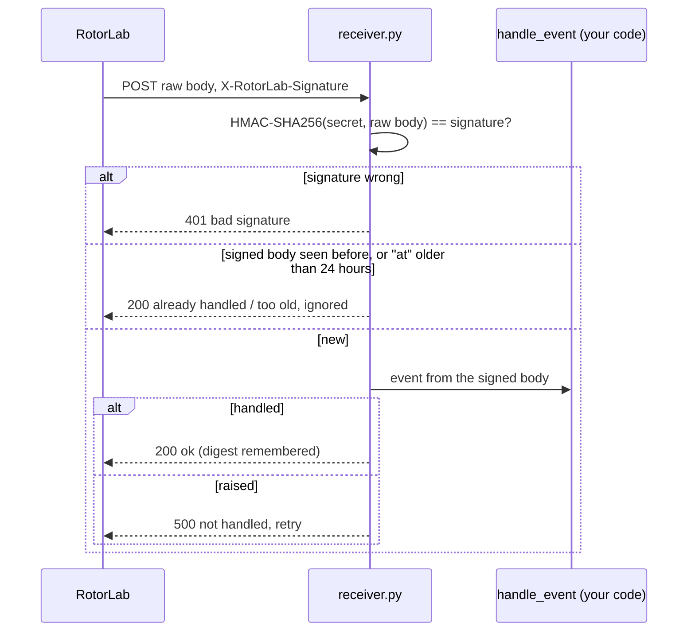

# Security model

What the examples do with your key and your data, what they refuse, and what stays your job when you copy them into your own systems. Every statement can be checked in the code and in `tests/test_examples.py`.

## The credentials

| Credential | Starts with | Who holds it | What it reaches |
|---|---|---|---|
| Personal API key | `rl_` | One person in your organization | The areas ticked at creation, and only what that person's role reaches. Read only or read and write. |
| Device credential | (issued on the Devices card) | The organization, for one ground station | `status`, `flights` and `checklists`. Keeps working after the person who created it leaves. |
| Webhook signing secret | `whsec_` | Your receiving endpoint | Nothing in RotorLab: it lets your endpoint check that a delivery came from RotorLab. |

RotorLab shows each of these once, at creation. A person may hold up to 25 active keys, the organization sets the longest a key may last, and organization admins see and can revoke every key.

**Least privilege, in practice:**

- Give each integration its own key, so revoking one leaves the others working.
- Tick only the areas the integration needs, and keep **Read only** unless it files records.
- For an AI assistant, untick everything except **AI assistant (MCP) reads**. That key cannot call the rest of the API.
- Choose the shortest end date that suits you.

## How the scripts handle the key

- The key comes only from `ROTORLAB_API_KEY`, never from a command-line argument or a file in this repository. The README sets it with `read -rs` (or `Read-Host` in PowerShell) so it stays out of shell history.
- The key travels only in the `Authorization: Bearer` header, never in a URL, and is never printed. `check_key.py` prints only the key's short prefix.
- The scripts send the key only to an `https://` address. Plain `http://` is refused unless the host is this computer.
- The scripts never follow a redirect. A redirect would carry the `Authorization` header to the new address, so it is reported as an error with its `Location` instead.
- Certificate checks use Python's default TLS context and are never turned off.

## How the webhook receiver checks a delivery

- The signature covers the raw body only, so the receiver verifies the exact bytes before parsing them, and takes the event name and time from the signed body, never from a header.
- Repeats are dropped by the SHA-256 of the body, which is identical on every retry. `X-RotorLab-Delivery` is not signed, so it is not trusted for this.
- A delivery is remembered only after it was handled; if handling fails, the receiver answers `500` so RotorLab retries.
- Each connection has its own thread and a socket timeout, so one slow client cannot hold up deliveries. Bodies over 1 MB are refused.
- RotorLab delivers only to `https://` addresses that resolve to the public internet and never follows a redirect. Run the receiver behind your own TLS-terminating proxy.

The receiver keeps its digests in memory. A real service keeps them in its database for at least the replay window.

## The MCP endpoint

- It is read-only: there is no tool that writes.
- The key's organization is the boundary for every read, and a member's key sees only the tools their role reads.
- No tool returns member lists, email addresses or pilot identities.
- MCP calls spend no quota or credits. Each key may send 60 requests a minute and 1,000 an hour.
- When you add the server to Claude Code, the `.mcp.json` form with `${ROTORLAB_API_KEY}` keeps the key out of the file. The `claude mcp add --header ...` form stores the expanded key in your user configuration; never run it with `--scope project`.

## What stays your job

- **Where the key lives.** On a server, load it from your secret store into the environment. Never commit it; `.gitignore` excludes `.env` files.
- **Exposed keys.** Revoke the key under Organization, Integrations, API keys and create a new one.
- **Your receiver's TLS, storage and handler.** The example receiver checks signatures and replays; what `handle_event` does with an event, and how you store the dedup digests, is up to you.
- **What you do with the answers.** A readiness reading or a currency value says what your records show. It never authorizes or clears a flight.

## Reporting a problem

Email security@rotorlab.app or use GitHub private vulnerability reporting on this repository. See [SECURITY.md](../SECURITY.md).
