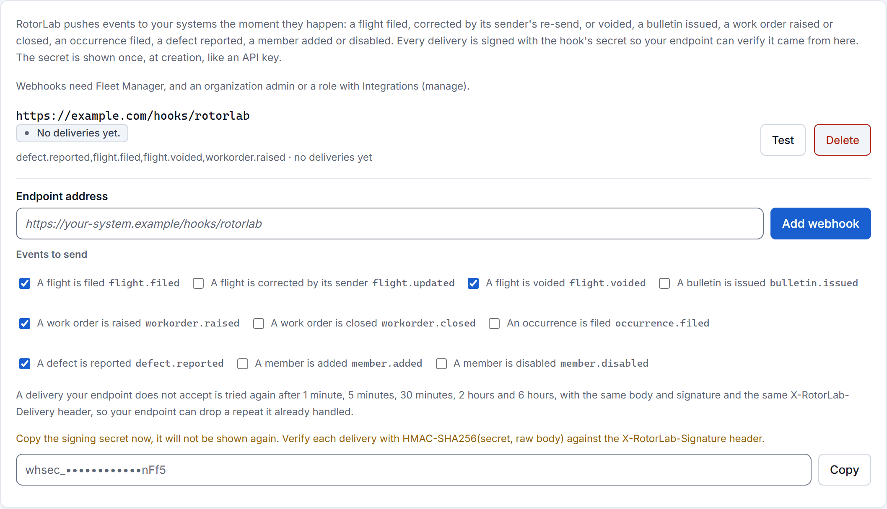

# Webhooks

Webhooks are configured in the app and are not part of the OpenAPI document; this page is their reference.

RotorLab can push events to your own systems as they happen, so you do not have to poll. Webhooks are available with Fleet Manager, and an organization admin, or a role with Integrations (manage), adds them in the app under Organization, Integrations, Webhooks.

When you add a webhook you give an `https://` endpoint address and pick the events to send. RotorLab then shows the hook's secret **once**. Store it like an API key: it is how your endpoint knows a delivery came from RotorLab. The Webhooks card can also send a test delivery (event `ping`).

<p align="center">
  <picture>
    <source media="(prefers-color-scheme: dark)" srcset="../docs/images/webhooks-dark.png">
    
  </picture>
  <br><sub>A webhook right after it was added, with its signing secret shown once (masked here). Fictional demo organization.</sub>
</p>

## Events

| Event | When | `data` carries |
|---|---|---|
| `flight.filed` | A new flight is on the record | `flight_id`, `asset_id`, `source`, `duration_s`, `external_ref`, `reference_conflict`, `mission_id` |
| `flight.updated` | A flight was corrected by its sender's re-send | the same fields as `flight.filed` |
| `flight.voided` | A flight was voided | `flight_id`, `asset_id`, `external_ref`, `reference_conflict` |
| `bulletin.issued` | A service bulletin was issued | `sb_id`, `ref`, `title`, `severity`, `type_id`, `type`, `orders` |
| `workorder.raised` | A work order was raised | `order_id`, `asset_id`, `title`, `priority`, `origin` |
| `workorder.closed` | A work order was closed | `order_id`, `asset_id`, `title`, `action`, `cause` |
| `occurrence.filed` | An occurrence was filed | `occurrence_id`, `ref`, `asset_id`, `flight_id`, `occurred_at`, `status` |
| `defect.reported` | A defect was reported | `defect_id`, `asset_id`, `title`, `severity`, `category`, `reported_on` |
| `member.added` | A member joined the roster | `user_id`, `ref`, `name`, `tier`, `active` |
| `member.disabled` | A member was disabled | `user_id`, `ref`, `name`, `why` |
| `ping` | A test delivery from the Webhooks card | `message` |

Payloads carry ids, names, references and counts about records. They carry no email addresses, tokens or positions. To read more, call the API with the id: for example `GET /api/v1/flights/{flight_id}` or `GET /api/v1/workorders/{order_id}`.

## What a delivery looks like

```http
POST /hooks/rotorlab HTTP/1.1
Content-Type: application/json
User-Agent: RotorLab-Webhook
X-RotorLab-Event: workorder.raised
X-RotorLab-Signature: sha256=3f9c...e1
X-RotorLab-Delivery: 1042
X-RotorLab-Attempt: 1

{"event": "workorder.raised", "at": "2026-11-14 18:02:11", "data": {"order_id": 88, "asset_id": 4, "title": "Replace motor 3", "priority": "routine", "origin": "manual"}}
```

- `at` is the time of the event in UTC.
- `X-RotorLab-Signature` is `sha256=` followed by the lowercase hex HMAC-SHA256 of the **raw request body**, keyed with the hook's secret (the whole secret string, as RotorLab showed it, encoded as UTF-8).
- `X-RotorLab-Delivery` is the delivery's id, the same on every retry. The signature covers the body only, not this header, so drop repeats by the body's SHA-256 (the body is identical on every retry) and ignore a delivery whose `at` is older than you keep those digests. A test `ping` carries no delivery id.
- Take the event name from the signed body, not from the `X-RotorLab-Event` header, which is not signed.

## Verify the signature

Compute the HMAC over the bytes exactly as received, before you parse or re-serialize the JSON, and compare in constant time:

```python
import hashlib, hmac

def verify(secret, raw_body, header_value):
    if not header_value:
        return False
    expected = "sha256=" + hmac.new(secret.encode("utf-8"), raw_body, hashlib.sha256).hexdigest()
    # compare bytes: a header with characters outside ASCII must not raise
    return hmac.compare_digest(expected.encode("ascii"),
                               header_value.strip().encode("latin-1", "replace"))
```

`receiver.py` in this folder is a complete standard-library receiver. It verifies the signature, drops a repeat by the SHA-256 of the body, ignores a delivery whose signed `at` is more than 24 hours old (`REPLAY_WINDOW_S`, longer than the retry schedule; widen it if your RotorLab server holds deliveries for longer, as in offline mode), remembers a delivery only after it was handled (answering `500` otherwise, so RotorLab retries), and serves each connection on its own thread with a socket timeout, so one slow client cannot hold up other deliveries. It prints each event:

```bash
read -rs ROTORLAB_WEBHOOK_SECRET && export ROTORLAB_WEBHOOK_SECRET   # paste the secret, then Enter
python receiver.py --port 8080
```

RotorLab delivers only to `https://` addresses that resolve to the public internet, and never follows a redirect. Run the receiver behind your own TLS terminating proxy or load balancer.

## Retries

Answer with any `2xx` status within 10 seconds to accept a delivery. Anything else, or no answer, is tried again after 1 minute, 5 minutes, 30 minutes, 2 hours and 6 hours, six attempts in all, with the same body, signature and delivery id. A hook whose deliveries fail 20 times in a row is turned off, and an organization admin can see that on the Webhooks card.
